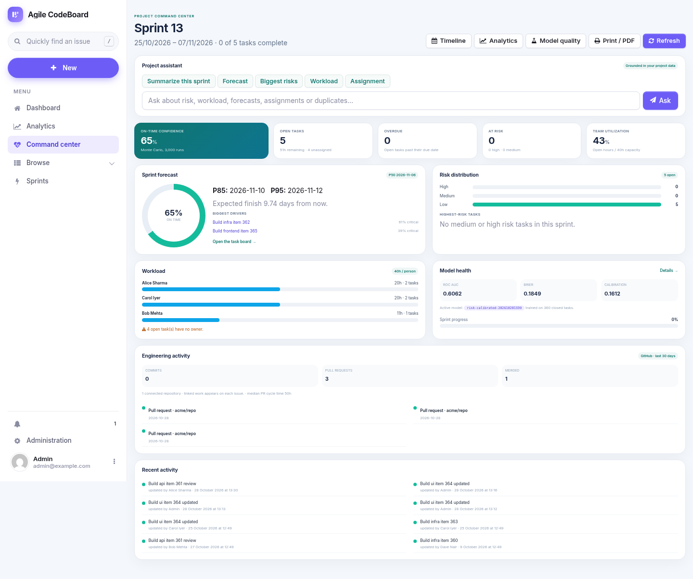
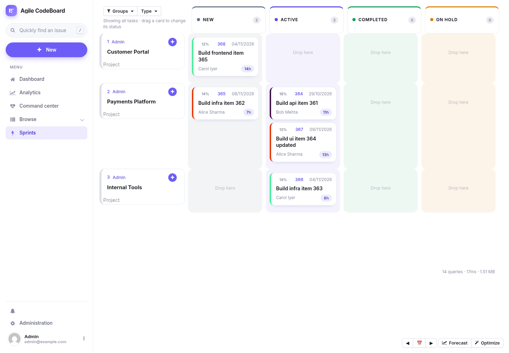
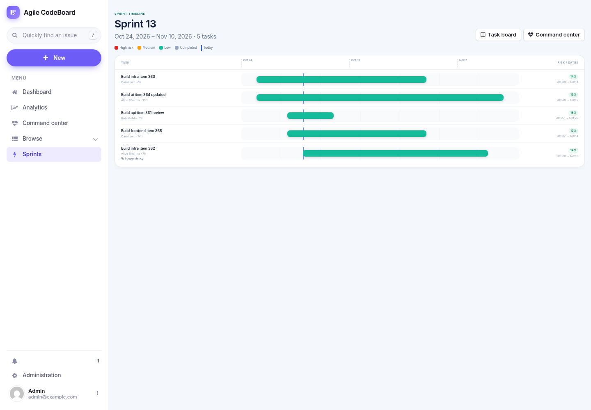
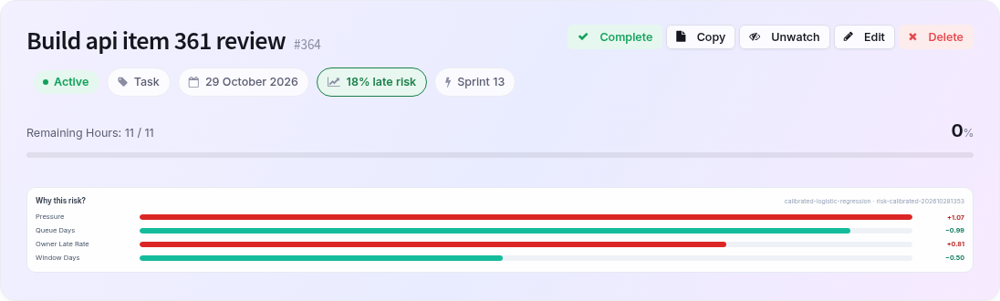
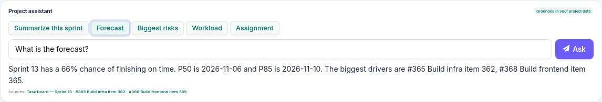
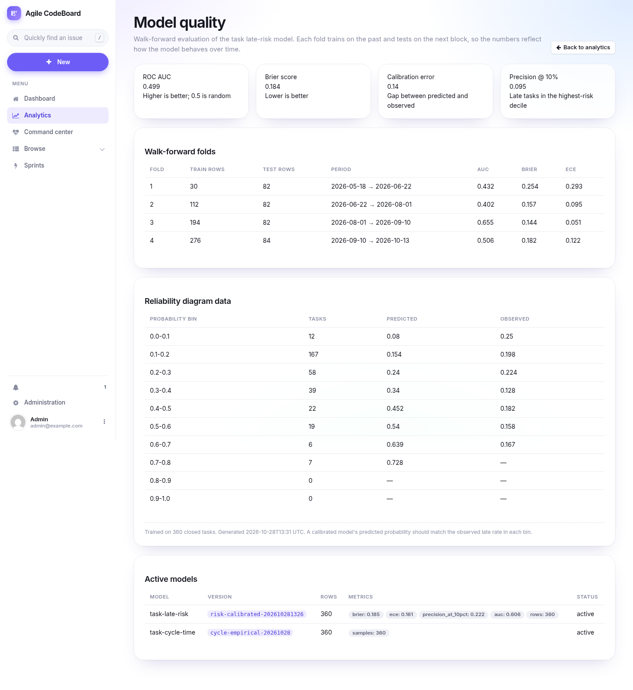
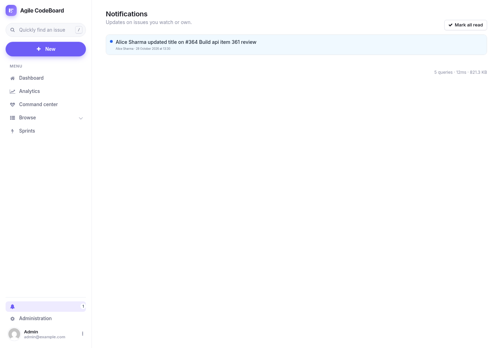
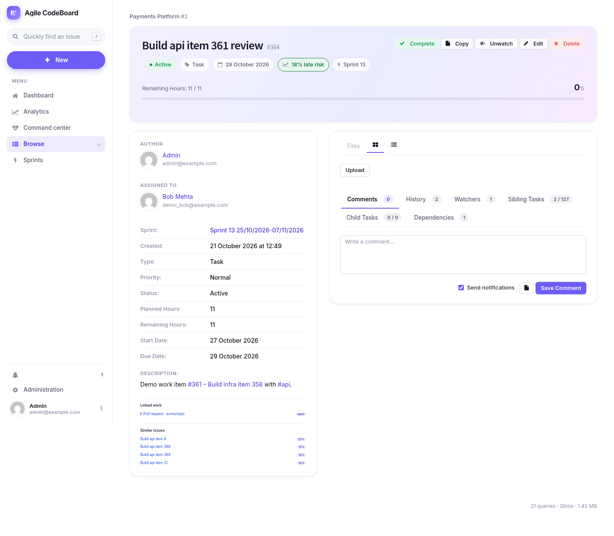

# Agile CodeBoard

**A project-management platform with a predictive, prescriptive and explainable intelligence layer.**

Agile CodeBoard is built on [Phproject](https://github.com/Alanaktion/phproject) (PHP / Fat-Free Framework) and adds a Python/FastAPI intelligence sidecar. The PHP application remains the system of record and owns authentication, access control and workflow. The ML service owns risk, forecasting, assignment optimization, duplicate detection and the grounded assistant.

**Runtime:** PHP **8.5.12** (latest security release) · MySQL 8 or SQLite · Python 3.12 · Docker Compose

**Changelog:** [CHANGELOG.md](CHANGELOG.md) · **Next-semester roadmap:** [ROADMAP.md](ROADMAP.md)

---

## Highlights

| Area | What it does |
|---|---|
| **Calibrated risk** | Predicts the probability that each open task finishes late, with per-issue explanations and model calibration metrics. |
| **Sprint forecasting** | Monte Carlo simulation over historical cycle times, dependencies and assignee capacity, with P50/P85/P95 dates and risk drivers. |
| **What-if planning** | Re-run a forecast with extra days or reduced/increased capacity before committing to a plan. |
| **Prescriptive assignment** | Ranks assignees, then solves the sprint as a CP-SAT assignment problem with capacity, WIP and fairness constraints. Review and apply changes in one action. |
| **Command center** | One page for sprint confidence, risk distribution, workload, model health, engineering activity and recent work. |
| **Sprint timeline** | Risk-colored Gantt-style bars with owners, hours, dependency counts and a today marker. |
| **Duplicate detection** | TF-IDF similarity over issue titles/descriptions, shown on issues and while drafting a new task. |
| **Grounded assistant** | Ask about forecast, risk, workload, assignments or duplicates; answers cite the project data they used. No external LLM key required. |
| **Notifications** | In-app notifications for watchers, owners and authors, with unread badges and mark-all-read. |
| **GitHub integration** | Signed webhooks link commits and pull requests to issues and store DORA-ready events. |
| **Evaluation** | Walk-forward backtesting, reliability curves, Brier score, ECE, precision@10% and a model registry. |
| **Feedback loop** | Every suggestion impression and acceptance is recorded so acceptance and realized lift can be measured. |

---

## Screenshots

### Project command center



### Task board with calibrated risk badges



### Sprint timeline



### Explainable AI — per-issue risk factors



### Grounded project assistant



### Model quality



### Notifications



### Issue page with linked work and duplicate detection



---

## Architecture

```text
Browser (Fat-Free views + vanilla JS + Chart.js)
   │
   ├── PHP application ──────────────► MySQL 8 / SQLite
   │      │
   │      ├── HTTP (internal token) ─► FastAPI ML service
   │      │                                ├── calibrated risk model
   │      │                                ├── Monte Carlo forecast
   │      │                                ├── CP-SAT assignment optimizer
   │      │                                ├── TF-IDF similarity search
   │      │                                └── grounded assistant
   │      │
   │      ├── GitHub webhooks ─────────► issue links + DORA events
   │      └── notifications / issue history
   │
   └── Optional profiles: Redis, Mercure, Qdrant, MailHog
```

The PHP app never shells out to Python. `Helper\Ml` calls the sidecar over HTTP with a timeout, an internal token and graceful fallback.

---

## Quick start

```bash
cp .env.example .env
docker compose up -d --build
docker compose exec app php cron/seed_demo.php
```

Open **http://localhost:9090**.

| Account | Password | Role |
|---|---|---|
| `admin` | `change-me-now` (`ADMIN_PASSWORD` in `.env`) | Admin |
| `demo_alice` | `demo1234` | User |
| `demo_bob` | `demo1234` | User |
| `demo_carol` | `demo1234` | User |
| `demo_dave` | `demo1234` | User |

The seed creates 5 users, 3 projects, 14 sprints, 360 closed tasks with realistic lateness profiles, current-sprint work, tags, dependencies and activation history.

Useful commands:

```bash
make migrate     # apply DB migrations
make seed        # deterministic demo data
make train       # recompute analytics through the ML service
make test        # PHP + Python tests
make lint        # phpcs + phpstan + ruff
make forecast    # forecast the current sprint
```

---

## Feature changelog — added in this session

The complete release-style changelog is in [CHANGELOG.md](CHANGELOG.md).

### 1. Platform foundation

- Added a FastAPI inference service under `ml-service/` with health, version and metrics endpoints, internal-token authentication and OpenAPI docs.
- Added a SQLAlchemy data layer that reads the same `config.php` as PHP and supports **MySQL and SQLite**.
- Replaced the PHP `exec()` bridge with `Helper\Ml`, an HTTP client with timeouts, error handling and a fallback path.
- Added a model registry (`model_run`) with version, row count, metrics, dataset hash and active flag.
- Added Docker Compose services for the app, MySQL, ML service, Redis, Mercure, Qdrant and MailHog, with health checks and dev profiles.
- Added multi-stage Docker images, a PHP 8.5.12 runtime, a one-command installer entrypoint and persistent config storage.
- Added dual-dialect migrations (`db/26.10.*.sql` and `.sqlite.sql`) and an engine-aware migration runner.
- Added GitHub Actions for PHP 8.5 (MySQL + SQLite), Python lint/pytest and Docker image builds.

### 2. Predictive intelligence

- **Calibrated late-risk model** trained on issue history and audit fields, with time-aware features (planned hours, priority, bug flag, window, queue time, pressure, owner trailing late rate, owner load).
- **Per-issue explanations** with the top contributing features and direction, rendered as a visible “Why this risk?” panel with impact bars.
- **Cycle-time estimates** (P50/P85/P95) from activation-to-close history.
- **Model quality metrics**: ROC AUC, Brier score, expected calibration error, precision at the top 10%, reliability bins and per-fold results.
- **Walk-forward backtesting** (`/v1/models/risk/backtest`) with weighted fold summaries.
- **Model registry** and `/intelligence/quality` admin page.
- **Batch risk** endpoint powering task-board and issue-list badges.

### 3. Prescriptive intelligence

- **Monte Carlo sprint forecasting** with dependency ordering, per-assignee queues, capacity, historical cycle-time sampling, fixed seed and explicit assumptions.
- **Risk drivers** showing which tasks are critical most often.
- **What-if scenarios** for extra days and capacity changes.
- **Assignee recommendations** for issues, sprints and draft tasks using on-time history, current load, tag overlap and capacity fit.
- **CP-SAT sprint optimizer** with one owner per task, capacity, WIP and a fairness cap; deterministic greedy fallback.
- **Baseline vs optimizer** comparison: expected fit, lift, changed owners, per-user projected hours and utilization.
- **Apply reviewed assignments** with manager/admin permission, issue-history logging and `assignment_run`/`assignment_item` audit rows.

### 4. Command center, timeline and assistant

- **Project command center** (`/intelligence/health`) combining sprint confidence, risk distribution, top risks, workload, model health, engineering activity and recent activity.
- **Sprint timeline** (`/intelligence/timeline/@id`) with risk-colored bars, owners, hours, dependency counts, weekly ticks, today marker and a legend.
- **Grounded project assistant** (`/intelligence/ask`) for sprint summaries, forecasts, risk, workload, assignments and duplicate questions, with citations and no free-form hallucination.
- **Print / PDF** styles for the command center.

### 5. Collaboration and search

- **In-app notification center** with per-user notifications for issue updates and comments, unread badge, polling, mark-read and mark-all-read.
- **Notification generation** from issue updates and comments, excluding the actor and targeting watchers, owners and authors.
- **Duplicate detection** using TF-IDF over issue titles and descriptions; similar-issues panel on every issue page.
- **Draft duplicate warning** on the new/edit issue form.
- **Issue-list and task-board risk badges** loaded in one batch request.

### 6. GitHub integration

- **Signed GitHub webhook receiver** at `/webhooks/github` with `X-Hub-Signature-256` verification when a secret is configured.
- **Commit and pull-request linking** via `#123` references in PR titles, bodies, branches and commit messages.
- **DORA-ready events** stored in `dora_event`, including PR cycle-time metadata.
- **Linked work** on the issue page and engineering activity on the command center.
- **Optional auto-close** of linked issues on PR merge (`github.auto_close`).
- Setup and a local simulation payload in [docs/github-integration.md](docs/github-integration.md).

### 7. Security, compatibility and data

- Added `model_run`, `prediction`, `suggestion_log`, `forecast_run`, `assignment_run`, `assignment_item`, `user_skill`, `user_availability`, `holiday`, `git_installation`, `issue_link`, `dora_event`, `audit_log`, `job`, `event_outbox` and `notification` tables, plus `issue.version` and query indexes.
- Widened `user.password`/`user.salt` for modern bcrypt hashes.
- Added CSRF protection to every new write route, issue-level access checks, manager/admin guards and access-filtered similarity results.
- Added signed webhook verification and secret configuration in the admin Integrations tab.
- Updated the runtime to **PHP 8.5.12** (latest security release), replaced the deprecated PDO MySQL option with `Pdo\Mysql::ATTR_INIT_COMMAND`, and pinned the Docker image.
- Updated `league/commonmark` to **2.10.4**; `composer audit --locked` reports **no security advisories**.
- Persisted `config.php` in a dedicated volume so container recreation cannot wipe the database.
- Hardened notification template rendering for installations without IMAP configuration.

### 8. Demo, docs and tests

- Added a deterministic `cron/seed_demo.php` generator with 360 closed tasks, 5 users, 3 projects, 14 sprints, tags, dependencies and issue history.
- Added `cron/migrate.php`, `cron/refresh_ml.php` and Makefile targets.
- Added `docs/intelligence-layer.md`, `docs/github-integration.md` and this README.
- Added **27 Python tests** covering health, auth, risk, batch risk, cycle time, forecasting, what-if, assignment, optimizer, backtesting, search and the assistant.
- Added **24 PHP tests** (2 skipped), with PHPCS, PHPStan and Ruff passing locally on PHP 8.5.12.
- Added UI screenshots under `docs/screenshots/`.

### Not yet implemented

- Real-time collaborative task board over SSE/WebSocket.
- Embedding-based semantic search (the current duplicate detector is TF-IDF).
- LLM-backed copilot (the current assistant is deliberately grounded and deterministic).
- Full GitHub App installation flow and a complete DORA dashboard.
- Multi-tenant workspaces, SSO and SCIM.
- GitLab support and an audit-log UI.

---

## Documentation

- [Intelligence layer: architecture, endpoints, migrations and development](docs/intelligence-layer.md)
- [GitHub integration and local webhook simulation](docs/github-integration.md)
- [User guide](docs/user-guide.md)
- [System flow diagram](docs/flow-diagram.html)

---

## License and upstream attribution

This project is a fork of [Phproject](https://github.com/Alanaktion/phproject) by Alan Hardman and is distributed under the **GNU General Public License v3.0 or later**. See [LICENSE](LICENSE).

**Intelligence layer and UI additions in this fork: added by Vedant Chalke.**
